# Clinic Front Desk Automation

**An AI front desk for a dental clinic that answers patients 24/7 in Arabic and English, books appointments, sends reminders, and alerts the team about anything urgent, with no manual work.**

Built with n8n, Google Gemini, Google Sheets, Gmail and Telegram.

---

## The problem

A clinic's front desk spends hours every day on the same messages: *"Are you open Friday?"*, *"How much is whitening?"*, *"Can I book for tomorrow at 6?"*. Bookings get lost in WhatsApp chats, angry patients wait too long for a reply, and patients forget their appointments. Every no-show is an empty chair.

## What this system does

- **Understands every message**, in Arabic or English. It works out what the patient wants (booking, question, complaint, other) and how urgent it is.
- **Books appointments automatically.** It saves them to a shared Google Sheet, emails the patient a confirmation in their own language, and pings the clinic on Telegram. If the date or time is missing, it asks the patient for it.
- **Answers common questions instantly**, using only the clinic's approved FAQ (hours, address, services, prices). It never invents an answer. When the FAQ doesn't cover a question, it tells the patient the team will reply and notifies staff.
- **Escalates complaints and emergencies** (severe pain, swelling, bleeding) to the clinic's Telegram right away, marked **URGENT**.
- **Cuts no-shows and keeps everyone informed.** Reminders go out automatically the day before each confirmed appointment, and the clinic gets a daily summary every evening. If anything breaks, the admin is alerted within seconds.

## How it works

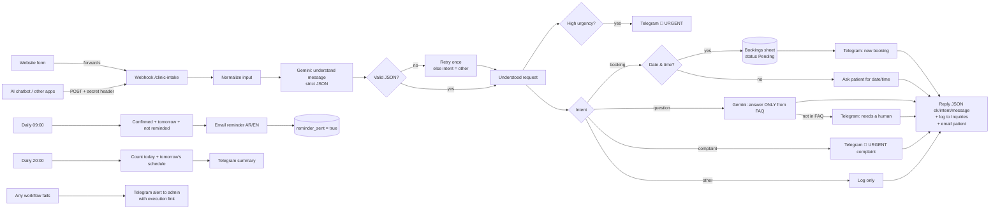

## Features

| | |
|---|---|
| 🌍 Bilingual | Detects Arabic or English and replies in the same language (right-to-left emails for Arabic) |
| 🤖 AI understanding | Intent, urgency, name, phone, email, preferred date/time ("next Sunday", "بكرة" → real dates) |
| 📅 Booking | Google Sheet as a simple booking system; staff confirm by changing one cell |
| ❓ FAQ answers | Strictly from the clinic's own FAQ, editable in one place |
| 🚨 Escalation | Complaints and emergencies reach the team on Telegram in seconds |
| ⏰ Reminders | Day-before email for confirmed appointments, never sent twice |
| 📊 Daily summary | Evening Telegram report with today's numbers and tomorrow's schedule |
| 🛡️ Monitoring | Any failure alerts the admin with a link to the exact execution |

## Results from the test run

`scripts/test-requests.sh` sends 11 realistic messages. Actual results:

| # | Input | Detected | What happened |
|---|---|---|---|
| 1 | EN: "teeth cleaning tomorrow at 5 pm" | booking | Row in Bookings (2026-11-11 17:00, Pending), confirmation email, Telegram to clinic |
| 2 | AR: "عايز أحجز كشف يوم الأحد الجاي الساعة 7 مساءً" | booking | "Next Sunday" resolved to 2026-11-15 19:00, Arabic confirmation email, Telegram |
| 3 | AR: "عايزة أحجز ميعاد تنظيف أسنان" (no date) | booking | Arabic email asking for day and time; logged |
| 4 | EN: "Open on Saturdays? Price of whitening?" | question | Answered from FAQ: "open 10:00–22:00 … whitening 3,500 EGP" (email + reply) |
| 5 | AR: female orthodontist? general anaesthesia? | question | Not in FAQ, so the patient is told the team will reply and staff are notified on Telegram |
| 6 | EN: angry complaint (waited 2 h, charged twice) | complaint | 🚨 URGENT Telegram, apology email, logged |
| 7 | AR: severe toothache + swollen face (chatbot, no email) | booking, **high** | 🚨 URGENT Telegram, reply "our team will call you right away" |
| 8 | Spam: "Buy 10,000 followers…" | other | Logged only, no email |
| 9 | Broken JSON body | – | HTTP 422, rejected by n8n before the workflow runs |
| 10 | JSON without `message` | – | HTTP 400 `{ "ok": false, ... }` |
| 11 | Wrong `X-Clinic-Secret` | – | HTTP 403, rejected |

## Screenshots

| | |
|---|---|
| 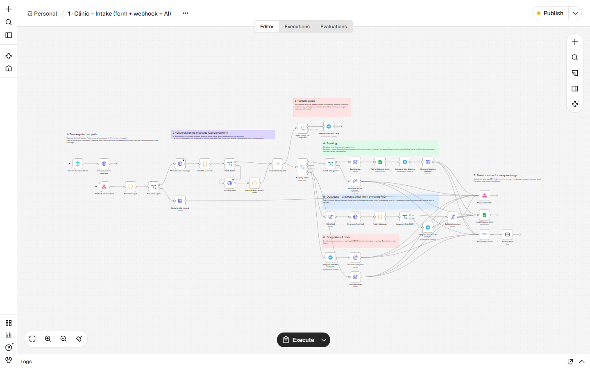 | 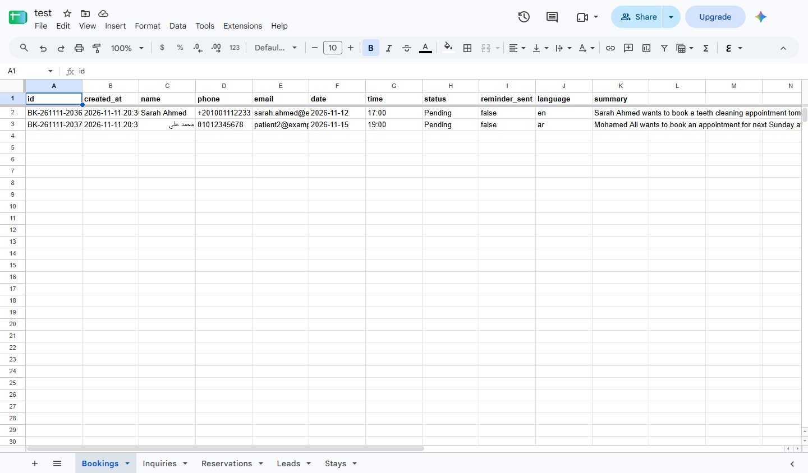 |
| Intake workflow (n8n) | Bookings sheet |
| 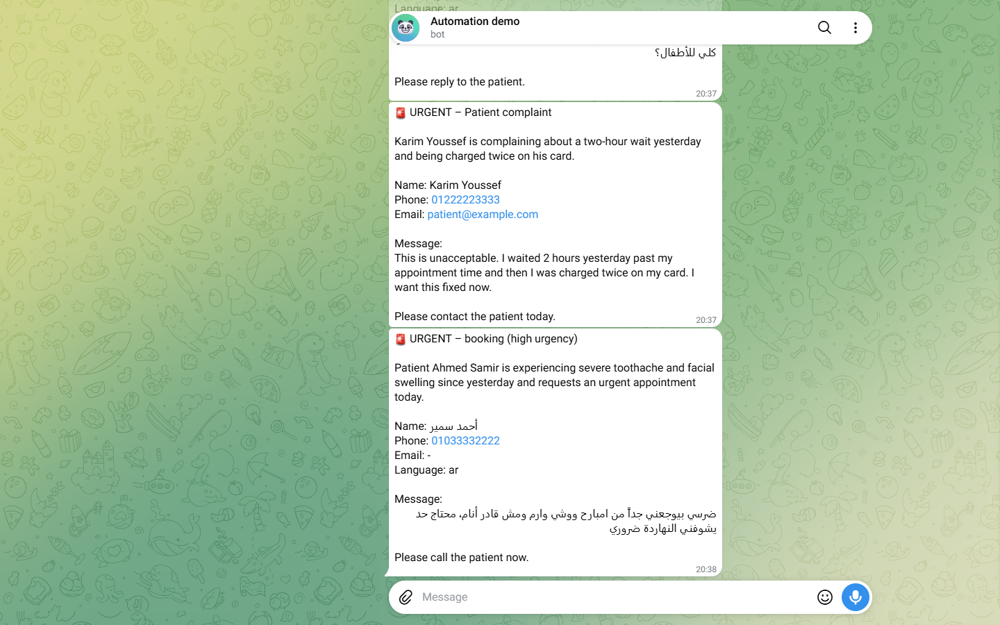 | 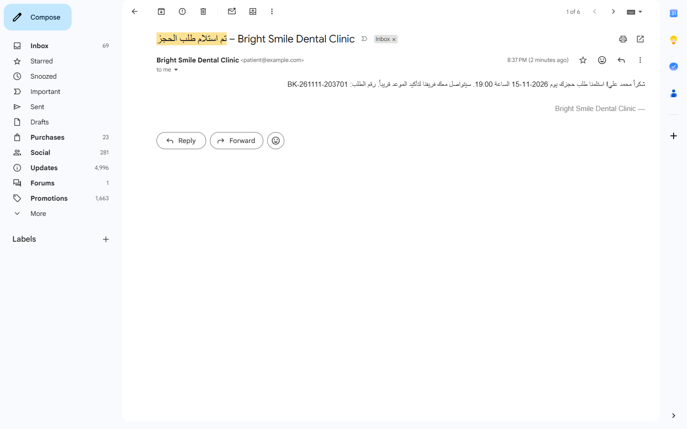 |
| Telegram: complaint and URGENT alerts | Arabic confirmation email |
| 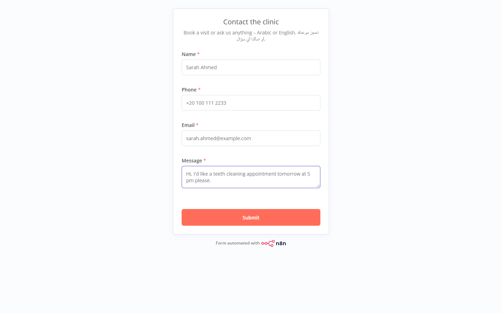 | 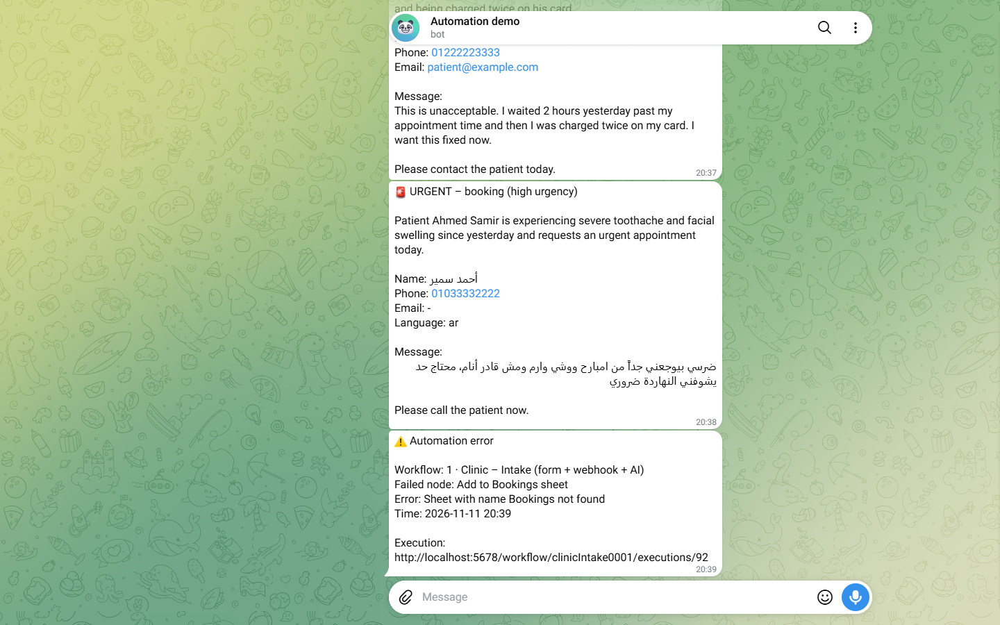 |
| Patient contact form | Error alert to admin |
| 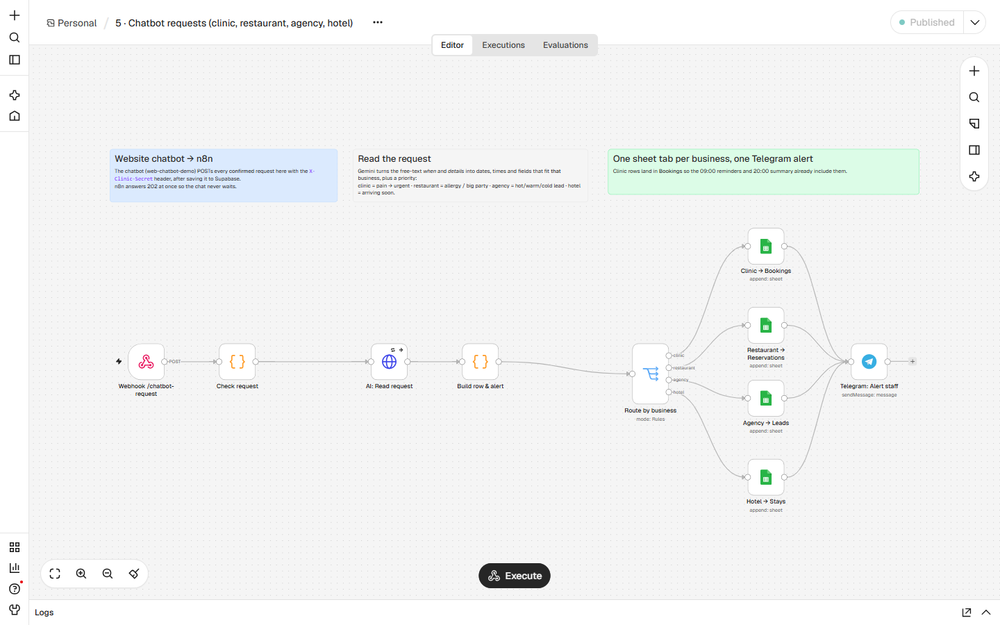 | 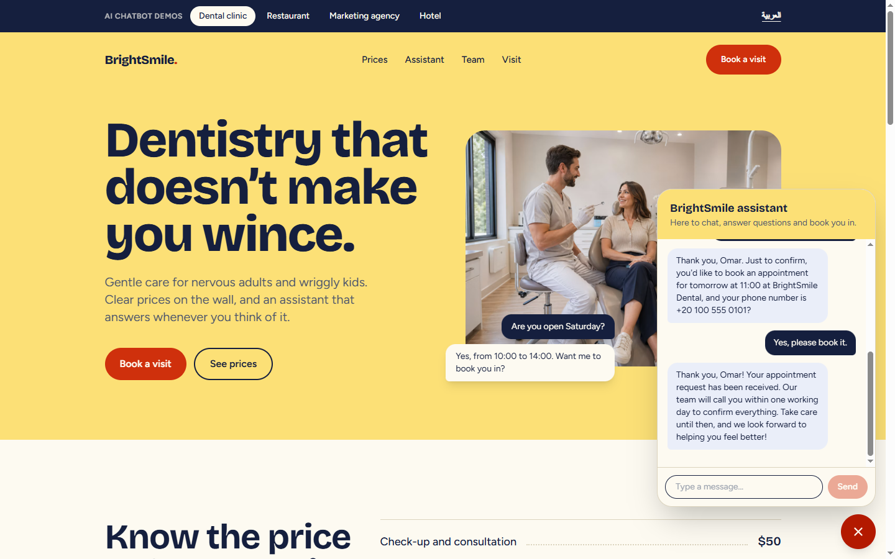 |
| Chatbot requests workflow: one route per business | The website chatbot taking a booking |
| 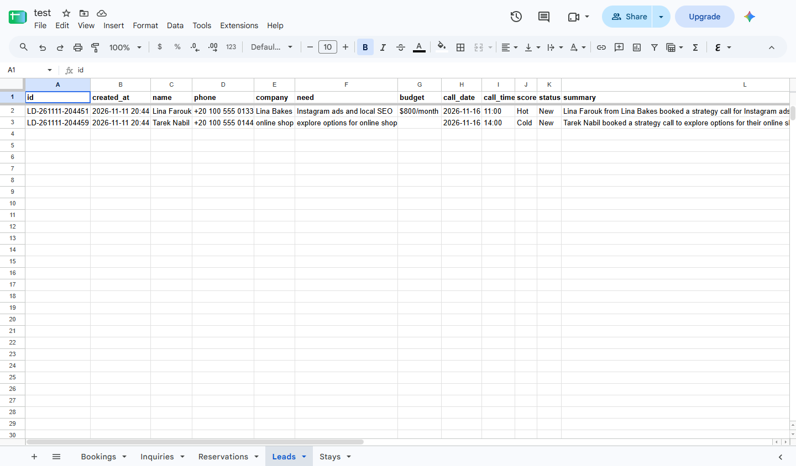 | 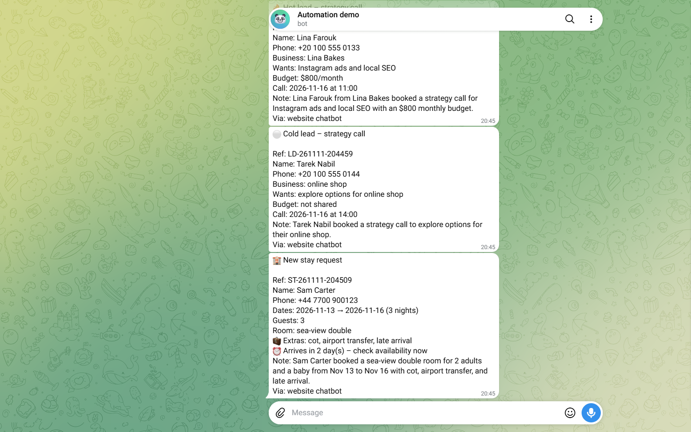 |
| Agency leads, scored Hot / Cold by AI | Telegram: hot/cold lead and hotel stay alerts |

---

# Technical section

## Tech stack

- **n8n 2.47.3** (self-hosted, Docker, official image), 4 workflows
- **Google Gemini API** (`gemini-flash-lite-latest`) with a JSON schema for structured output
- **Google Sheets** via a Service Account (Bookings + Inquiries tabs)
- **Gmail SMTP** with an App Password
- **Telegram Bot API** for clinic and admin alerts

## Workflows

| File | Name | Trigger |
|---|---|---|
| `workflows/1-intake.json` | Intake (form + webhook + AI) | Form, `POST /webhook/clinic-intake` |
| `workflows/2-reminders.json` | Appointment reminders | Daily 09:00 Africa/Cairo, + "Run now" |
| `workflows/3-daily-summary.json` | Daily summary | Daily 20:00 Africa/Cairo, + "Run now" |
| `workflows/4-error-handler.json` | Error handler | Error Trigger (error workflow of 1–3, 5) |
| `workflows/5-chatbot-requests.json` | Website chatbot requests (clinic, restaurant, agency, hotel) | `POST /webhook/chatbot-request` from [web-chatbot-demo](https://github.com/Abdullah-Othman0/web-chatbot-demo) |

## Setup (about 15 minutes)

1. Install Docker Desktop and clone this repo.
2. `cp .env.example .env` and fill in every value (see the table below).
3. Save the Google service-account key as `secrets/google-service-account.json`. Share your Google Sheet with the service account's email as **Editor**.
4. `docker compose up -d`, then open http://localhost:5678 and create the n8n owner account.
5. `./scripts/setup-credentials.sh` creates all 5 n8n credentials from `.env`, encrypted, with no secret files left behind.
6. `./scripts/setup-sheet.sh` creates the **Bookings**, **Inquiries**, **Reservations**, **Leads** and **Stays** tabs with headers.
7. `./scripts/import-workflows.sh` imports and publishes all five workflows.
8. `./scripts/test-requests.sh` sends the 11 sample messages. Check the sheet, Telegram and your inbox.

## Importing workflows manually

In n8n, go to **Workflows → Import from File** and pick each JSON in `workflows/`. Then attach your credentials to the nodes that show a warning and click **Publish**. Publish `4-error-handler` too: n8n 2.x only runs published error workflows. The exports contain **no credential data**, only credential names and IDs.

## Using it

- **Webhook (chatbot / other apps):**
  ```bash
  curl -X POST http://localhost:5678/webhook/clinic-intake \
    -H "Content-Type: application/json" -H "X-Clinic-Secret: $WEBHOOK_SECRET" \
    -d '{"name":"Sara","phone":"0100…","email":"sara@example.com","message":"Can I book a check-up tomorrow at 6 pm?"}'
  # → {"ok":true,"intent":"booking","message":"Thank you Sara! We received your booking request ..."}
  ```
  Only `message` is required. The `message` in the response is ready to show to the patient, so a chatbot can reply with it directly.
- **Website chatbot ([web-chatbot-demo](https://github.com/Abdullah-Othman0/web-chatbot-demo)):** set `N8N_WEBHOOK_URL=http://localhost:5678/webhook/chatbot-request` and `N8N_WEBHOOK_SECRET` (= `WEBHOOK_SECRET`) in the chatbot's `.env.local`. Each request the visitor confirms is sent here as `{business, name, phone, when, details}`. Gemini reads it with rules for that business, and it is filed and alerted on like this:

  | Business | Sheet tab | What the automation adds |
  |---|---|---|
  | clinic | Bookings | dates parsed so the 09:00 reminder and 20:00 summary include it; pain or swelling → 🚨 URGENT alert |
  | restaurant | Reservations | guests, allergies, occasion; ⚠️ allergy and 👥 8+ guests flagged for the kitchen |
  | agency | Leads | company, need, budget; lead scored 🔥 Hot / 🟡 Warm / ⚪ Cold |
  | hotel | Stays | check-in/out and nights; extras (cot, transfer, late arrival); ⏰ arriving within 3 days flagged |
- **Form:** `http://localhost:5678/form/5b0a4f0e-3c1e-4c55-9a0d-c11c1a000001`
- **Staff:** change a booking's `status` from `Pending` to `Confirmed` in the sheet. The reminder is sent the day before.
- **Test the schedules now:** `./scripts/run-now.sh reminders` or `./scripts/run-now.sh summary`
- **Clean the sheet before a demo:** `./scripts/setup-sheet.sh --reset`

## Environment variables

| Variable | Purpose |
|---|---|
| `N8N_VERSION` | n8n image tag (tested: 2.47.3) |
| `N8N_PORT` | Port of the n8n editor on your machine |
| `N8N_ENCRYPTION_KEY` | Encrypts saved credentials. Set once, never change it |
| `WEBHOOK_URL` | Public base URL of n8n (webhook URLs, execution links in alerts) |
| `TZ` | Clinic timezone for schedules (`Africa/Cairo`) |
| `CLINIC_NAME` | Used in emails, prompts and Telegram messages |
| `WEBHOOK_SECRET` | Value callers must send in the `X-Clinic-Secret` header |
| `GEMINI_API_KEY` | Google AI Studio API key |
| `GEMINI_MODEL` | Gemini model (default `gemini-flash-lite-latest`) |
| `GOOGLE_SHEET_ID` | ID from the sheet URL |
| `SMTP_USER` / `SMTP_PASS` | Gmail address + 16-character App Password |
| `SMTP_FROM_NAME` | Sender name patients see |
| `TELEGRAM_BOT_TOKEN` | Bot token from @BotFather |
| `TELEGRAM_CHAT_ID` | Clinic chat (bookings, urgent alerts, summary) |
| `TELEGRAM_ADMIN_CHAT_ID` | Admin chat for technical error alerts |

## Reliability

- **Authenticated webhook.** Every call must carry the `X-Clinic-Secret` header, or it gets HTTP 403. The public form goes through the same protected path.
- **Input validation.** Inputs are trimmed and length-limited, and a missing message returns a clean HTTP 400 JSON. Malformed JSON is rejected by n8n (HTTP 422) before any processing.
- **AI output is never trusted blindly.** Gemini is forced into a JSON schema, then a Code node validates every field (allowed values, date `YYYY-MM-DD`, time `HH:mm`). Broken output triggers one retry, then a safe fallback to `other` for manual review.
- **Retries.** Every Gemini call and every sheet write retries 3× on network errors or rate limits.
- **Safe under load.** Sheet rows are added with Google's atomic append, so messages arriving at the same moment never overwrite each other (tested with 5 simultaneous requests).
- **No hallucinated answers.** Questions are answered only from the clinic FAQ. Unknown questions go to a human.
- **No duplicates.** Reminders flip `reminder_sent` after sending, so reruns never email twice.
- **Error alerts.** Workflows 1–3 and 5 report failures to the admin's Telegram with the workflow name, failed node, error message and a direct execution link.
- **No secrets in the repo.** `.env` and `secrets/` are git-ignored. Credentials are created from `.env` inside the container and stored encrypted, and workflow exports contain only credential references.

## Easy to extend

- **WhatsApp Business API.** Point a WhatsApp Cloud API webhook at `/clinic-intake` and send `message` back as the reply. No core changes needed.
- **Google Calendar.** Add a "Create event" node after *Add to Bookings sheet* to block the dentist's calendar, and check free slots before confirming.
- **CRM.** Push each patient to HubSpot, Zoho or Odoo from the *Log to Inquiries* step.
- **Arabic voice notes.** Transcribe audio (e.g. Gemini audio or Whisper) into `message` before *Normalize input*. Everything downstream already works.
- **Production AI.** Switch to a paid Gemini key so patient data is not used for training, or swap the HTTP node to OpenAI or Claude.

## Project structure

```
docker-compose.yml        n8n (official image, pinned), volume, TZ, env
.env.example              every variable documented
workflows/                4 clean exports (no credential data)
scripts/
  setup-credentials.sh    .env → encrypted n8n credentials
  setup-sheet.sh          create tabs + headers (--reset to clear rows)
  import-workflows.sh     import + publish workflows
  test-requests.sh        11 Arabic/English webhook samples
  run-now.sh              run reminders / summary on demand
docs/
  loom-script.md          90-second demo video script
  upwork-portfolio.md     portfolio title, description, skills
```
